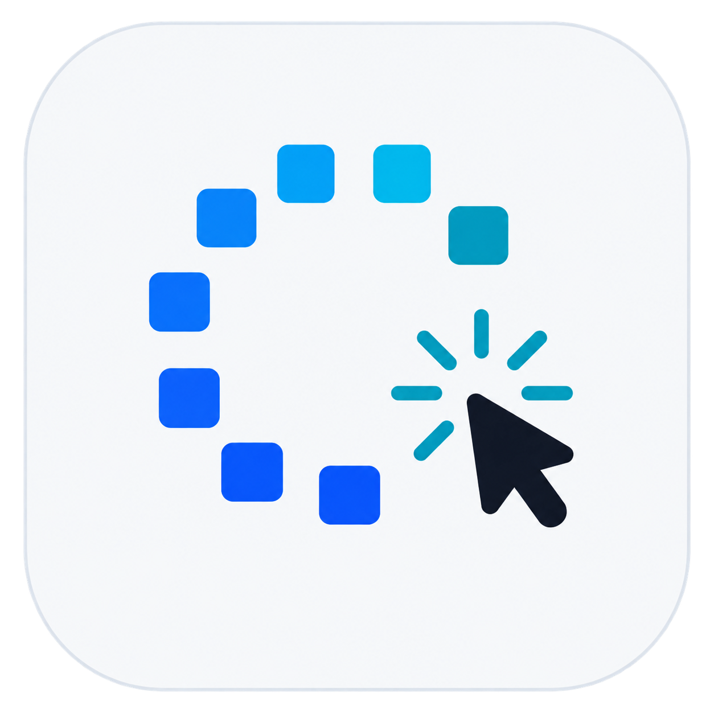

<p align="center">
  <picture>
    <source media="(prefers-color-scheme: dark)" srcset="Autoclick-Web/public/logo/autoclick-logo-dark.png">
    
  </picture>
</p>

# AutoClick PFI

AutoClick permite crear y ejecutar automatizaciones en Windows, de forma manual o con ayuda de IA. Utiliza modelos autohosteados mediante Ollama.

**En producción, la IA se ejecutará en la infraestructura de AutoClick**, en un equipo de altos recursos administrado por nosotros. Cada usuario podrá utilizar la aplicación sin tener que alojar los modelos en su computadora.

Durante las pruebas y el entrenamiento utilizamos **Runpod para alquilar una GPU por hora**. Fue una herramienta de desarrollo; no es un requisito para usar el proyecto.

La web ya está disponible en **[autoclick.website](https://autoclick.website)** e incluye la landing, el dashboard y el panel de administración.

Esta guía explica cómo ejecutar el código del repositorio para realizar pruebas.

## Qué contiene cada carpeta

| Carpeta | Contenido |
| --- | --- |
| `Autoclick-App` | Aplicación de escritorio, editor y ejecución de bots. |
| `Autoclick-IA` | Servicio que recibe las consultas y se comunica con los modelos. |
| `Autoclick-MCP` | Herramientas y catálogo de bloques que utiliza la IA. |
| `Autoclick-Cloud` | Código y configuración de los servicios de AWS. |
| `Autoclick-Web` | Código de la landing, el dashboard y la administración. |
| `Autoclick-Models` | Configuración e instalador de los modelos. Los pesos se descargan por separado al obtener el código de GitHub. |

## Antes de empezar

El funcionamiento completo requiere **servicios de AWS activos y correctamente conectados**, una cuenta AutoClick habilitada y acceso a los modelos. AWS y el alojamiento generan costos según los recursos y el consumo mensual.

El repositorio **no incluye cuentas, certificados de acceso ni claves privadas**. Estos accesos se administran por separado. El código se puede modificar para adaptarlo a otra infraestructura; la configuración incluida utiliza AWS y no prepara una cuenta nueva desde cero.

## 1. Preparar la computadora

Para ejecutar el escritorio, usar Windows 10/11 de 64 bits e instalar:

- [Node.js](https://nodejs.org/en/download): versión 24 LTS.
- [WebView2 Runtime](https://developer.microsoft.com/en-us/microsoft-edge/webview2/): si no está instalado.
- [uv](https://docs.astral.sh/uv/getting-started/installation/): instala Python y las dependencias del proyecto.

Para instalar uv, abrir PowerShell y ejecutar:

```powershell
powershell -NoProfile -ExecutionPolicy Bypass -c "irm https://astral.sh/uv/install.ps1 | iex"
```

Después, cerrar y volver a abrir PowerShell. Ollama sólo es necesario en el equipo que alojará los modelos. Las acciones de Excel requieren Microsoft Excel y las de OCR, Tesseract; la prueba de esta guía no los necesita.

## 2. Descargar e instalar el proyecto

Descargar o clonar [este repositorio](https://github.com/SantiBilli/AutoClick-PFI) y abrir PowerShell en su carpeta. Si se recibe el ZIP completo `AutoClick-PFI.zip`, extraerlo primero: ese paquete ya incluye ambos modelos.

Guardar la configuración autorizada de AWS en `Autoclick-Cloud/deployment.json`. Se proporciona por separado. Para una instalación propia, copiar `deployment.example.json` con ese nombre y completar sus valores; `DesktopClientId` corresponde al escritorio y `WebClientId`, a la web. Este archivo queda fuera de Git.

Desde la carpeta que contiene `Start-AutoClick.ps1`, ejecutar:

```powershell
powershell -NoProfile -ExecutionPolicy Bypass -File .\Start-AutoClick.ps1 -SetupOnly
```

Este paso instala las dependencias y crea la configuración inicial. Requiere los datos de conexión anteriores, pero todavía no verifica certificados ni inicia la aplicación. **Los comandos siguientes también parten de esta carpeta**, salvo cuando se indique otra ubicación.

## 3. Archivos de configuración

Los archivos `.env` guardan la configuración de cada instalación:

| Archivo | Para qué sirve |
| --- | --- |
| `Autoclick-IA/.env` | Dirección de Ollama y nombres de los modelos. |
| `Autoclick-IA/.env.cloud` | Conexión del servicio de IA con AWS. |
| `Autoclick-App/frontend/.env.local` | Conexión del escritorio con los servicios y el inicio de sesión. |
| `Autoclick-Web/.env.local` | Configuración de la web cuando se ejecuta localmente. |
| `Autoclick-IA/deploy/.env.example` | Plantilla opcional para alojar el servicio de IA en un servidor con Docker. |

`-SetupOnly` crea los tres primeros. Los `.env.example` son plantillas; los archivos con la configuración real no se publican en Git. El iniciador conserva los archivos existentes: después de editarlos, reiniciar los servicios.

Para administrar la infraestructura con CDK, completar `Autoclick-Cloud/cdk.local.json` usando `cdk.local.example.json` y aportar el certificado público de la CA del despliegue en `Autoclick-Cloud/infra/worker-ca.pem`. Ambos quedan fuera de Git. `desktopUnlimitedSub` es una excepción opcional para una cuenta administradora; vacío, no se habilita esa excepción.

## 4. Preparar los accesos

Para probar la aplicación completa se necesita una **cuenta AutoClick habilitada**, con organización, área y cuota de IA, y una identidad autorizada para el servicio local de IA.

Crear la carpeta de esa identidad:

```powershell
New-Item -ItemType Directory -Force -Path "$env:LOCALAPPDATA\AutoClick\WorkerIdentity" | Out-Null
```

Colocar allí:

- `worker.pem`: certificado proporcionado por el administrador de AutoClick.
- `worker-key.pem`: su clave privada, proporcionada junto con el certificado.
- `aws_signing_helper.exe`: herramienta para Windows disponible en [AWS](https://docs.aws.amazon.com/rolesanywhere/latest/userguide/credential-helper.html).

El iniciador prepara el perfil `autoclick-worker` si no existe y lo utiliza para obtener accesos temporales a AWS. **No hace falta usar las claves personales de AWS del desarrollador.** Si el perfil ya existe, debe corresponder al despliegue autorizado. Conservar estos archivos fuera del repositorio.

## 5. Preparar los modelos

| Uso | Modelo |
| --- | --- |
| Principal, ajustado por el equipo de AutoClick | `autoclick-8b:entrega33` |
| Respaldo (fallback) | Modelo a elección |

El de AutoClick se utiliza primero. Como fallback se puede elegir **cualquier modelo de texto compatible con Ollama**. Ambos deben estar instalados en el servidor.

El modelo de AutoClick es un ajuste de **Qwen3-8B**. Su descarga incluye la [licencia original Apache 2.0](Autoclick-Models/LICENSE-Qwen3-8B.txt) y un [aviso de los cambios realizados](Autoclick-Models/NOTICE-entrega33.txt).

### Usar un servidor ya preparado

Si se dispone del servidor de AutoClick u otro servidor autorizado, solicitar su dirección y configurarla en `Autoclick-IA/.env`. En ese caso, no es necesario descargar los modelos en la PC del escritorio.

```dotenv
OLLAMA_BASE_URL=http://127.0.0.1:11434
OLLAMA_MODEL=autoclick-8b:entrega33
OLLAMA_FALLBACK_MODEL=modelo-de-respaldo
```

Reemplazar `modelo-de-respaldo` por el nombre exacto del modelo elegido. `127.0.0.1` corresponde a la misma computadora; para un servidor remoto, usar su dirección. Conservar los demás parámetros del archivo.

### Alojar los modelos para pruebas

También se pueden alojar en un equipo propio con recursos suficientes para los modelos elegidos. Los siguientes pasos se realizan en el equipo que ejecutará Ollama:

1. Instalar [Ollama](https://ollama.com/download). Si ya quedó abierto, cerrarlo desde su icono antes de continuar.
2. Crear una carpeta para la descarga:

   ```powershell
   New-Item -ItemType Directory -Force -Path .\.autoclick\model-download | Out-Null
   ```

3. Descargar **[autoclick-8b-entrega33.zip desde Google Drive](https://drive.google.com/file/d/1xm-bloKJpJChrqb5f4J_Slai-HL4LCCJ/view?usp=drivesdk)** y guardarlo en esa carpeta. Pesa unos **5 GB**; conservar el ZIP y el modelo instalado requiere unos **10 GB**, además del espacio del respaldo.
4. Después de completar el paso 2 de esta guía, instalarlo:

   ```powershell
   & .\Autoclick-IA\.venv\Scripts\python.exe .\Autoclick-Models\install_entrega33.py --archive .\.autoclick\model-download\autoclick-8b-entrega33.zip
   ```

   El instalador verifica el archivo y restaura los pesos en `Autoclick-Models`. Si se usa el ZIP completo de entrega, omitir la descarga y esta instalación: los pesos ya están incluidos.

5. Iniciar Ollama con esos modelos y mantener la terminal abierta:

   ```powershell
   $env:OLLAMA_MODELS = (Resolve-Path '.\Autoclick-Models\ollama-models').Path
   $env:OLLAMA_HOST = '127.0.0.1:11434'
   ollama serve
   ```

6. En otra terminal, descargar el respaldo elegido si no está instalado. Usar el mismo nombre configurado en `OLLAMA_FALLBACK_MODEL`:

   ```powershell
   $env:OLLAMA_HOST = '127.0.0.1:11434'
   ollama pull modelo-de-respaldo
   ollama list
   ```

La descarga de Drive contiene sólo el modelo de AutoClick. El ZIP completo incluye también un respaldo, que puede reemplazarse por otro. Si los modelos se alojan en otra máquina, su administrador debe habilitar la conexión por una red privada y proporcionar su dirección.

## 6. Iniciar y probar AutoClick

Con los accesos y los modelos preparados, ejecutar desde la raíz del proyecto:

```powershell
powershell -NoProfile -ExecutionPolicy Bypass -File .\Start-AutoClick.ps1
```

El iniciador comprueba los servicios y abre la ventana de AutoClick. Para ejecutar bots, usar esa ventana de escritorio.

1. Ingresar con una cuenta habilitada.
2. En **Explorador → Seleccionar carpeta**, elegir una carpeta vacía para las pruebas.
3. Pulsar **Crear bot**, agregar el bloque **Esperar** y poner **Milisegundos = 1000**.
4. Pulsar **Validar**, **Guardar** y **Ejecutar**. El bot debe finalizar con estado **Completado**.
5. Abrir **Asistente IA** y pedir: «Creá un bot con un único bloque Esperar de 1000 milisegundos».
6. Revisar el borrador, confirmar **Crear Bot** y ejecutarlo desde el editor.

La primera respuesta de IA puede tardar mientras se carga el modelo. Sin accesos válidos se pueden instalar las dependencias y revisar el código, pero no completar esta prueba.

Para cerrar la aplicación y sus servicios locales:

```powershell
powershell -NoProfile -ExecutionPolicy Bypass -File .\Stop-AutoClick.ps1
```

Ollama se detiene por separado, con `Ctrl+C` en su terminal.

## 7. Usar la web

La forma más sencilla es entrar a **[autoclick.website](https://autoclick.website)**. Los paneles requieren una cuenta habilitada; la administración requiere el rol `AUTOCLICK_ADMIN`.

Para ejecutar la web localmente, dejar libre el puerto 3000 y abrir otra terminal desde la raíz del proyecto:

```powershell
Set-Location .\Autoclick-Web
npm.cmd ci
$webCloud = Get-Content '..\Autoclick-Cloud\deployment.json' -Raw | ConvertFrom-Json
if (!(Test-Path '.env.local')) {
    @(
        "NEXT_PUBLIC_COGNITO_USER_POOL_ID=$($webCloud.UserPoolId)"
        "NEXT_PUBLIC_COGNITO_CLIENT_ID=$($webCloud.WebClientId)"
        "NEXT_PUBLIC_AUTOCLICK_API_URL=$($webCloud.ApiUrl)"
    ) | Set-Content '.env.local' -Encoding utf8
}
npm.cmd run dev
```

Abrir **[http://localhost:3000](http://localhost:3000)**. La copia local usa los mismos servicios de AWS configurados; los cambios realizados desde los paneles afectan a ese despliegue. Para detenerla, pulsar `Ctrl+C` en su terminal.

## Si algo no funciona

| Problema | Qué revisar |
| --- | --- |
| No se reconoce un comando | Instalar la herramienta correspondiente y abrir otra terminal. |
| Falta la identidad del servicio | Revisar los tres archivos del paso 4 y la vigencia del certificado. |
| Ollama no responde o falta un modelo | Revisar la dirección de `.env`, el servidor y que `ollama list` muestre ambos modelos. |
| No permite ingresar o usar IA | Revisar la cuenta, la organización, el área y la cuota con el administrador. |

Los registros de inicio se guardan en `.autoclick`. El repositorio está preparado para ejecutar la aplicación; no incluye datasets ni scripts de entrenamiento.

## Autores

- Santiago Felipe Billinghurst
- Juana Estarli

Proyecto Final de Ingeniería — Ingeniería en Informática, UADE (2026).
